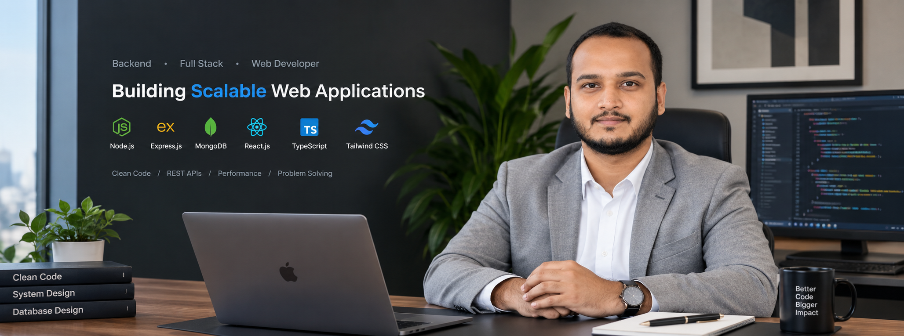

# Md. Rakibur Rahman

**Backend-Focused Full-Stack Software Engineer**  
*Building resilient server-side architectures, high-throughput media pipelines, and mission-critical production web systems.*

---

## ⚡ Executive Summary

I am a **Backend-Focused Full-Stack Software Engineer** specializing in the **Node.js, TypeScript, Express, Next.js, and React** ecosystems. Currently engineering production backend architectures and enterprise management systems at **Spark Tech Agency**, my work centers on designing fault-tolerant REST and RPC APIs, scalable database schemas, multi-gateway billing pipelines, and responsive real-time distributed services.

My engineering philosophy prioritizes **clean boundaries, strict type contracts, defensible database design, and end-to-end security**. I build software designed to withstand operational scale—decoupling business logic from HTTP transports, automating asynchronous workloads through distributed queues, and ensuring high observability across every layer.

---

## 🏛️ Core Engineering Strengths

- **Clean Architecture & Domain Separation:** Decoupled service layers, clear domain boundaries, and modular controller-service-repository patterns that keep large-scale codebases maintainable.
- **Defensive Type Safety & Contract Validation:** End-to-end type soundness with TypeScript and runtime boundary enforcement using Zod schemas at both HTTP and inter-service layers.
- **Financial & Idempotent Transactions:** Resilient multi-gateway payment integrations (Stripe, Stripe Connect, PayFast, Apple In-App Purchases, Google Play) equipped with webhook verification and atomic state updates.
- **Distributed Queues & Background Processing:** Offloading intensive workloads (video transcoding, push notifications, batch emails, payment reconciliations) via BullMQ worker clusters and Redis.
- **Security-First Engineering:** Robust authentication pipelines leveraging short-lived JWTs, HTTP-only refresh cookies, sliding-window rate limiting, Helmet hardening, and role-based access control (RBAC).
- **Relational & Document Data Modeling:** High-performance database designs spanning normalized PostgreSQL schemas, optimized MongoDB collections with aggregation pipelines, and strategic Redis caching.

---

## 🛠️ Technical Capabilities

### Core Runtime & Languages


### Backend Architecture & Microservices


### Databases & In-Memory Caching


### Security, Auth & Gateways


### Frontend Engineering & Dashboards


### Cloud, Media & Infrastructure


---

## 🚀 Featured Engineering Projects

### 1. ENG Sports Infrastructure & Enterprise Ecosystem
> **Production Sports League Platform, Media Transcoding Pipeline & Admin Dashboard**

- **Status**: **Live in Production**
- **Live Demonstrations**: [Admin Portal](https://admin.engsportsevents.co.uk) | [Production API](https://api.engsportsevents.co.uk)
- **Source Code**: [Backend Repository](https://github.com/rakiburrahman307/eng-backend) | [Enterprise Dashboard Repository](https://github.com/pranab56/eng-dashboard)
- **Primary Technologies**: Node.js, Express, TypeScript, Next.js 15, React 19, MongoDB (Mongoose), Redis, BullMQ, Socket.IO, AWS S3, Fluent-FFmpeg, Stripe, Brevo, Firebase Admin (FCM), Redux Toolkit, TanStack Table.
- **The Problem**: Coordinating multi-tier sports leagues, tournament brackets, player transfers, and video broadcasts requires synchronized real-time state, high-throughput asynchronous video processing, and a low-latency administration dashboard for match officials.
- **Architectural Implementation**:
  - **Dual API Communication Layer**: Engineered RESTful route contracts alongside high-throughput gRPC protocol buffers (`@grpc/grpc-js`, `protobufjs`) for low-latency inter-service data transmission.
  - **Automated Video Transcoding Pipeline**: Implemented an automated encoding workflow using `fluent-ffmpeg` and `ffmpeg-static` for HLS stream preparation, paired with AWS S3 presigned upload transfers to eliminate server memory exhaustion during multi-gigabyte video uploads.
  - **Asynchronous Task Architecture**: Built robust BullMQ worker queues on Redis to schedule push notifications (FCM), automated match reminders, transactional emails (Brevo), and coin transaction ledgers without blocking event loops.
  - **Real-Time Synchronization**: Configured Socket.IO clusters backed by `@socket.io/redis-adapter` for multi-instance event synchronization, match status updates, and live score telemetry.
  - **Enterprise Dashboard**: Built a Next.js 15 App Router administration portal utilizing TanStack Table for server-side paginated rosters, Redux Toolkit session persistence, and Recharts metric summaries.

---

### 2. Creepy Shorts — Video Streaming Platform & Content Engine
> **High-Performance Video-on-Demand Platform, Bunny Stream CDN & Multi-Store Billing**

- **Status**: **Live in Production**
- **Live Demonstrations**: [Web Platform](https://creepy-shorts.com) | [Production API](https://api.creepy-shorts.com)
- **Source Code**: [Backend Repository](https://github.com/rakiburrahman307/creepy-backend)
- **Primary Technologies**: Node.js, Express, TypeScript, MongoDB (Mongoose), Redis, BullMQ, BunnyCDN Storage & Stream, Stripe, Apple In-App Purchase Verification (`node-apple-receipt-verify`), Socket.IO, Passport.js OAuth2, Winston, Zod.
- **The Problem**: High-concurrency video entertainment platforms require resilient video delivery networks with zero-buffer streaming, strict subscriber entitlements across Web and iOS stores, and real-time interaction (chat, comments, watch bookmarks).
- **Architectural Implementation**:
  - **Global Media Delivery & CDN Integration**: Integrated BunnyCDN Storage and Bunny Stream pull-zones for automated transcoding and secure, distributed edge video delivery.
  - **Cross-Platform Entitlements & Billing**: Integrated dual subscription billing channels coordinating Stripe recurring webhooks and Apple App Store receipt validation (`node-apple-receipt-verify`).
  - **Real-Time Community & User Activity**: Engineered Socket.IO bidirectional channels for interactive messaging, paired with Redis caching for user viewing history, watch reminders, and content bookmarks.
  - **Security & OAuth Pipeline**: Configured Passport.js with Google and Facebook OAuth 2.0 flows, sliding-window rate limiting, and Winston structured log rotation.

---

### 3. Yoga With Jen — Fitness Streaming & Global Subscription Platform
> **Production On-Demand Video Fitness Architecture & Recurring Billing**

- **Status**: **Live in Production**
- **Live Demonstrations**: [Web App](https://app.yogawithjen.life) | [Production API](https://api.yogawithjen.life)
- **Source Code**: *Client codebase under NDA* (Ref: `yoga-with-jen-backend`)
- **Primary Technologies**: Node.js, Express, TypeScript, MongoDB (Mongoose), Redis, BullMQ, BunnyCDN, AWS S3, Stripe Webhooks, Apple IAP, Google Play Billing, Twilio.
- **The Problem**: Providing low-latency video streaming to global subscribers while managing multi-store subscription lifecycles, user sessions, and localized scheduling without service interruptions.
- **Architectural Implementation**:
  - **Multi-Store Subscription Synchronization**: Unified recurring billing across Stripe, Apple App Store, and Google Play Billing APIs with idempotent webhook processing.
  - **Resilient Video Streaming**: Implemented multi-part uploads with AWS S3 signed URLs and BunnyCDN edge caching.
  - **Task Queue Pipelines**: Delegated transactional email delivery, push notifications, and daily subscriber renewals to BullMQ workers backed by Redis.

---

### 4. Loan Management & Financial Servicing Platform
> **Multi-Party Loan Origination, Borrower Servicing & Automated Payout Engine**

- **Status**: **Client Project — Staging / Pre-Production**
- **Source Code**: [Backend Repository](https://github.com/rakiburrahman307/loan-management-backend)
- **Primary Technologies**: Node.js, Express, TypeScript, MongoDB (Mongoose), Redis, BullMQ, Stripe & Stripe Connect, Passport.js (OAuth2 + JWT), Winston, Zod, Helmet.
- **The Problem**: Loan origination platforms demand airtight security, strict audit logging, automated multi-step repayment schedules, and programmatic escrow disbursements while preventing double-charges and race conditions.
- **Architectural Implementation**:
  - **Financial Ledger & Stripe Connect**: Integrated Stripe Connect workflows for merchant/borrower onboarding, automated disbursements, and idempotent webhook handlers guarding loan repayment state transitions.
  - **Queue-Driven Payment Reminders**: Architected background workers using BullMQ and Redis for scheduled delinquency checks, interest calculation sweeps, and automated notification dispatches, monitored through an integrated Bull Board dashboard.
  - **Layered Security Hardening**: Enforced HTTP Parameter Pollution (`hpp`) protection, MongoDB sanitization (`express-mongo-sanitize`), sliding-window rate limiting (`express-rate-limit`), and defensive runtime validation using Zod.
  - **Enterprise Observability**: Configured Winston daily rotating file logging with custom exception and rejection handlers, guaranteeing full auditability across all loan ledger modifications.

---

### 5. University Academic Management Architecture
> **Relational Domain-Driven Academic ERP & Curriculum Engine**

- **Status**: **Open-Source Architectural Reference**
- **Source Code**: [Backend Repository](https://github.com/rakiburrahman307/university-backend-ts)
- **Primary Technologies**: Node.js, Express, TypeScript, MongoDB (Mongoose), Zod, JWT, Cloudinary, Multer, Nodemailer.
- **The Problem**: Managing academic institutions involves intricate dependency graphs: prerequisite course verification, multi-semester registration windows, faculty-department hierarchies, and role-segregated administrative access.
- **Architectural Implementation**:
  - **Formal Domain Modeling**: Produced comprehensive Entity-Relationship (ER) schemas and requirement specifications detailing relational hierarchies across Users, Faculties, Departments, Courses, and Semesters.
  - **Transaction-Safe Operations**: Structured course enrollment algorithms preventing over-subscription and enforcing prerequisite completion before course assignment.
  - **Documented API Surface**: Authored complete Postman API collections and architectural documentation, ensuring uniform REST response envelopes and centralized global error handling.

---

## ⚙️ Backend Engineering Deep Dive

```
┌────────────────────────────────────────────────────────────────────────┐
│                      PRODUCTION BACKEND TOPOLOGY                       │
└────────────────────────────────────────────────────────────────────────┘
          │
          ▼
   [ Nginx / Reverse Proxy & TLS Termination ]
          │
          ▼
   [ Express.js Gateway ]
    ├── Security Pipeline (Helmet, CORS, HPP, Mongo-Sanitize)
    ├── Sliding-Window Rate Limiting (Redis / In-Memory)
    ├── Authentication (JWT Access / HTTP-Only Refresh / RBAC)
    └── Request Contract Validation (Zod Schemas)
          │
          ├──► [ REST / gRPC Controllers ] ──► [ Service Domain Logic ]
          │                                          │
          │                                 ┌────────┴────────┐
          │                                 ▼                 ▼
          │                           [ MongoDB / PG ]   [ Redis Cache ]
          │                                                   │
          └──► [ Distributed Worker Clusters (BullMQ) ] ◄─────┘
                ├── Video Encoding (FFmpeg / Bunny Stream)
                ├── Push Notifications (Firebase FCM)
                ├── Webhook Retries & Billing Reconciliations
                └── Scheduled Maintenance & Reports (Cron)
```

- **API Architecture:** Clean separation of concerns with controllers delegating directly to stateless service classes. Standardized API response contracts `{ success, statusCode, message, meta, data }` and centralized exception normalization.
- **Database Engineering:** Optimized document schemas with compound indexing on query filters; ACID transactions for multi-document ledger operations; Redis cache-first lookup patterns with TTL and explicit invalidation.
- **Real-Time Systems:** Socket.IO multi-room architectures with Redis pub/sub adapters to scale horizontal WebSocket traffic across clustered Node.js worker instances.
- **Asynchronous Reliability:** Resilient BullMQ workers with exponential backoff retry strategies, dead-letter job isolation, and Bull Board administrative telemetry.
- **Financial Integrity:** Webhook signature verification, idempotency keys, and asynchronous event reconciliation to prevent duplicate charges or inconsistent states.

---

## 💻 Development & Deployment Standards

- **Environment & Secret Management:** Strict schema validation for environment configurations at boot time; zero hardcoded secrets.
- **Containerization & Deployment:** Docker multi-stage builds for lean production images, Docker Compose for local service orchestration (Node, Redis, MongoDB, Postgres), and deployment via Linux VPS, Nginx reverse proxy, and PM2 process management.
- **Code Hygiene & CI:** ESLint, Prettier, and TypeScript strict mode enabled across all active repositories. Commit conventions follow Conventional Commits standard.

---

## 📈 GitHub Activity & Engineering Metrics

<p align="center">
  
  
</p>

---

## 📬 Connect & Collaborate

- **LinkedIn**: [linkedin.com/in/rakibur-rahman-14b33a2a4](https://www.linkedin.com/in/rakibur-rahman-14b33a2a4)
- **Email**: [rakiburrahman.dev@gmail.com](mailto:rakiburrahman.dev@gmail.com)
- **GitHub**: [github.com/rakiburrahman307](https://github.com/rakiburrahman307)
- **Location**: Dhaka, Bangladesh

---

> *"Production software isn't just about writing code that works—it's about architecting systems that fail gracefully, scale reliably, and remain maintainable long after deployment."*
